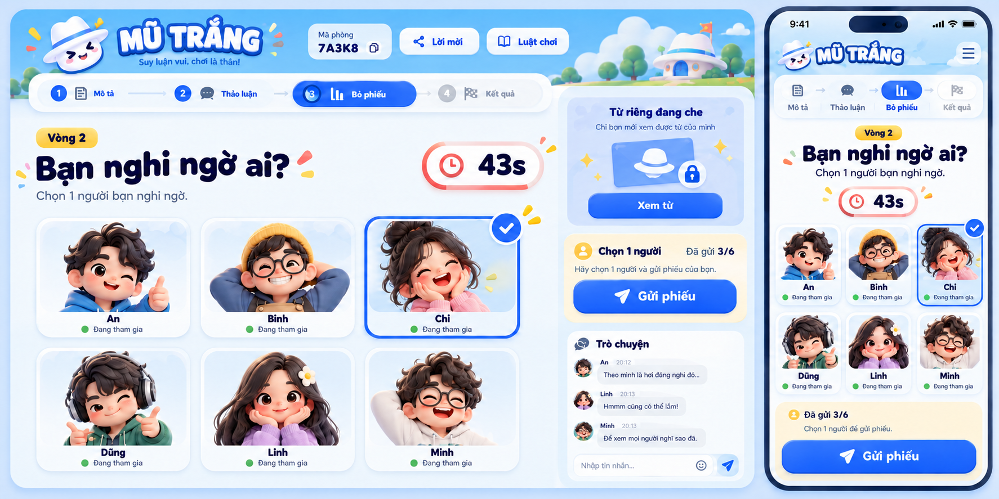

# Change: redesign-white-hat-secret-party

## Trạng thái

Người dùng đã duyệt concept Secret Party và yêu cầu triển khai qua câu trả lời “Duyệt, triển khai Secret Party” ngày 2026-10-27. Triển khai đúng concept và spec dưới đây, không cần cổng duyệt bổ sung. Chỉ archive sau nghiệm thu.

## Mục tiêu

Biến Mũ Trắng từ giao diện khung thông tin màu tối thành một party game trực quan, giàu nhân vật và phản hồi tương tác. Thay toàn bộ lớp hiển thị của game bằng hướng **Secret Party**; không chỉ đổi vài biến màu trên layout cũ.

## Concept đề xuất

Ảnh là bản thiết kế tham chiếu được tạo bằng imagegen, chưa phải ảnh chụp giao diện đang chạy. Tên người, mã phòng, thời gian và bộ đếm trong sản phẩm sẽ luôn lấy dữ liệu thật.

- Nền sáng xanh băng, bề mặt trắng, xanh cobalt làm màu chính, cam san hô và vàng tươi làm điểm nhấn; loại bỏ nền xanh đen và màu vàng kim hiện tại.
- Avatar nhân vật 3D vui nhộn, mascot mũ trắng và card hồ sơ bí mật. Avatar chỉ là danh tính hiển thị, hoàn toàn độc lập với role.
- Bố cục sân chơi với nhân vật chọn được, thanh tiến trình vòng, đồng hồ nổi bật và khu hành động rõ ràng; thay danh sách checkbox bằng card nhân vật vẫn giữ semantics checkbox và bàn phím.
- Nút nổi có phản hồi nhấn, dấu xác nhận chọn vote, spotlight lượt mô tả, bong bóng lời mô tả và màn thắng có hiệu ứng ăn mừng ngắn.
- Đồng bộ theme cho phòng chờ, cấu hình quản trò, mọi giai đoạn chơi, kết quả, chat, lời mời, luật chơi, quản lý và thông báo mất kết nối.

## Phạm vi / tương thích

Chỉ thay giao diện Mũ Trắng. Giữ luật, API, ID lệnh, deadline, dữ liệu trong RAM, quyền điều hành, bộ lọc từ/role, hành vi reconnect và điều kiện thắng. Poker, Bài nói dối và trang vào phòng chung giữ giao diện hiện có. Không thêm XP, điểm, cấp độ, tiền ảo, thưởng hoặc bảng xếp hạng. Không thêm dependency hoặc dịch vụ ngoài.

## Tiêu chí nghiệm thu

- Các màn Mũ Trắng có ngôn ngữ hình ảnh mới nhất quán, không dùng token màu hoặc style của theme bàn bài hiện tại.
- Nhìn ra ngay vòng, giai đoạn, lượt, thời gian, lựa chọn vote và trạng thái gửi lệnh. Số liệu đều lấy từ snapshot.
- Người chơi vẫn không nhận nhãn role hoặc từ của người khác; avatar, màu và hiệu ứng không suy ra role bí mật.
- Từ đang che không xuất hiện trong DOM hoặc accessibility labels; blur/offline/reload giữ cơ chế che hiện có.
- Chơi được từ 320px tới desktop; quản trò điều hành 12 người; nút chạm ít nhất 44px, input ít nhất 16px, hỗ trợ bàn phím và reduced motion.
- Có ảnh kiểm tra phòng chờ, mô tả, vote, đoán cuối, kết quả và dialog; các kiểm thử gameplay và hồi quy hai game khác đạt.
- Chạy tests, lint, typecheck, build, format và E2E; dừng đúng tiến trình kiểm thử đã tạo. Chỉ archive sau nghiệm thu.
